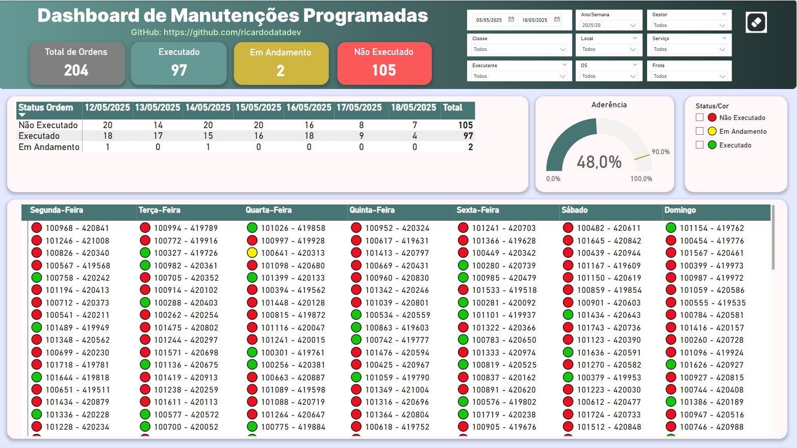

# 🚧 Dashboard de Manutenções Programadas 🚧

Finalizei mais um painel desenvolvido com foco na gestão de manutenções industriais!
Esse dashboard permite acompanhar de forma visual e prática:

✅ Quantidade total de manutenções programadas
🟢 Ordens executadas
🟡 Em andamento
🔴 E o que ainda não foi executado

Também é possível aplicar filtros para analisar por gestor responsável, classe de equipamento, frota, local ou semana específica.

Na parte inferior, destaque para a visualização por dias da semana, onde cada ordem é sinalizada com marcadores coloridos que indicam seu status.

Além disso, o painel também apresenta a taxa de aderência, indicando o percentual de execuções concluídas em relação ao planejado — uma métrica essencial para a área de manutenção!

🛠️ Uma solução que pode ajudar bastante a monitorar processos, reduzir falhas e tomar decisões com mais agilidade.

